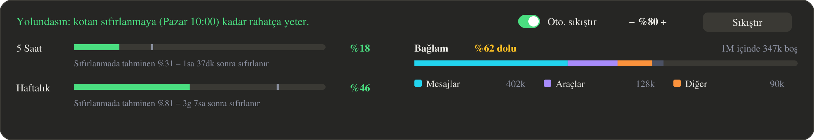
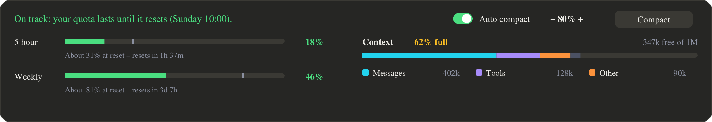

<div align="center">

# 📊 Usage Band · Kota Bandı

**İstem kutusunun hemen üstünde limitler, tahmin, bağlam ve oto-sıkıştırma.**<br>
**Limits, forecast, context and auto-compact, right above the prompt.**

[](#-türkçe)
[](#-english)
[](https://github.com/yigityildiz0/claude-usage-band/archive/refs/heads/main.zip)




</div>

---

## 🇹🇷 Türkçe

Kaç mesaj hakkın kaldığını, kotanın sıfırlanmaya yetip yetmeyeceğini ve bağlamın ne kadar dolduğunu, sohbetten ayrılmadan istem kutusunun üstünde görürsün.

| Bölüm | Ne gösteriyor |
|---|---|
| 🟢 **Başlık** | Bu hızla kotanın sıfırlanmaya yetip yetmeyeceğini tek cümleyle söyler. |
| ⏱️ **5 Saat / Haftalık** | Kullanılan yüzdeyi gösterir. Çubuktaki gri çentik, **sıfırlandığında nerede olacağının tahminidir**. Altında sıfırlanmaya kalan süre yazar. |
| 🧠 **Bağlam** | Doluluk yüzdesi ve boş alan; Mesajlar / Araçlar / Diğer diye ayrılmış hâliyle. |
| 🔁 **Oto. sıkıştır** | Anahtarla açılıp kapanır. Eşik **−/+** ile 5'er 5'er ayarlanır (%15–%95). Bağlam eşiğe gelince, tur bittiğinde sohbet kendiliğinden sıkıştırılır. |
| 🗜️ **Sıkıştır** | Tek tıkla hemen sıkıştırır. |

Renkler: limitte %75'ten sonra sarı, %90'dan sonra kırmızı; bağlamda %50'den sonra sarı, %80'den sonra kırmızı.

### ⬇️ Kurulum

**Claude Code terminalinde** şunu yaz:

```
/plugin install kota-bandi --marketplace yigityildiz0/claude-usage-band
```

Soru gelince `y` yaz, sonra Enter'a bas. Bant hemen görünür; `/kota` yazarak açıp kapatabilirsin.

**Kabuktan** kurmak için:

```bash
claude plugin install kota-bandi --marketplace yigityildiz0/claude-usage-band
```

**Masaüstü uygulamasında** şu adımları izle:
1. İstem kutusunun yanındaki **+** düğmesine bas.
2. **Plugins** → **Add marketplace** seç ve `yigityildiz0/claude-usage-band` yaz.
3. **Add plugin** ile `kota-bandi` modunu ekle.

> 🤖 **Claude'a yaptırmak istersen** şu mesajı aynen yapıştır:
>
> ```
> Claude Code için "kota-bandi" modunu kur: marketplace yigityildiz0/claude-usage-band.
> Türkçe sürümü (kota-bandi) kur, İngilizce usage-band'i kurma. Kurduktan sonra
> istem kutusunun üstündeki bandın göründüğünü kontrol et.
> ```

### 🤝 Claude Ofis ile birlikte

[claude-pixel-office](https://github.com/yigityildiz0/claude-pixel-office) de kuruluysa oto-sıkıştırma ayarı **ortaktır**: ofis panelinden de bu banttan da değiştirebilirsin. İkisi birlikte kuruluyken sıkıştırmayı yalnızca bu bant yapar, böylece sohbet iki kez sıkıştırılmaz.

> ⚠️ Aynı modun iki dilini birlikte kurma: ya `kota-bandi` ya `usage-band`.

Bu mod, Anant Raghunath'ın [usage-quota](https://github.com/anantraghunath/claude-code-usage-quota-mod) modunun MIT lisanslı bir çatalıdır. Eklenenler: Türkçe arayüz, hata düzeltmeleri, ofisle ortak oto-sıkıştırma. Ayrıca tema okumak için artık her 15 saniyede bir pencere açan bir süreç başlatmıyor.

---

## 🇬🇧 English

See how much of your quota is left, whether it lasts until the reset, and how full the context is, right above the prompt without leaving the chat.



| Part | What it shows |
|---|---|
| 🟢 **Headline** | One sentence: at this pace, does your quota last until it resets? |
| ⏱️ **5 hour / Weekly** | The % used. The grey tick on the bar is **where you are forecast to be at the reset**. Below it, the time left until the reset. |
| 🧠 **Context** | How full it is and what is free, split into Messages / Tools / Other. |
| 🔁 **Auto compact** | Turned on and off with the switch. The threshold steps by 5 with **−/+** (15%–95%). At the threshold, the chat compacts by itself once the turn ends. |
| 🗜️ **Compact** | Compacts now, in one click. |

Colours: limits turn amber at 75% and red at 90%; the context turns amber at 50% and red at 80%.

### ⬇️ Install

**In a Claude Code terminal**, type:

```
/plugin install usage-band --marketplace yigityildiz0/claude-usage-band
```

When asked, type `y`, then press Enter. The band shows at once; type `/quota` to show or hide it.

**From a shell**:

```bash
claude plugin install usage-band --marketplace yigityildiz0/claude-usage-band
```

**In the desktop app**:
1. Click **+** next to the prompt box.
2. Choose **Plugins** → **Add marketplace** and enter `yigityildiz0/claude-usage-band`.
3. Use **Add plugin** to add `usage-band`.

> 🤖 **To let Claude do it**, paste this message:
>
> ```
> Install the Claude Code mod "usage-band" from the marketplace
> yigityildiz0/claude-usage-band (the English one, not kota-bandi),
> then check that the band shows above the prompt.
> ```

### 🤝 With Claude Office

If [claude-pixel-office](https://github.com/yigityildiz0/claude-pixel-office) is installed too, the auto-compact setting is **shared**: change it from the office pane or from this band. With both installed, only this band does the compacting, so the chat never compacts twice.

> ⚠️ Install only one language of a mod: `usage-band` or `kota-bandi`.

This mod is an MIT-licensed fork of [usage-quota](https://github.com/anantraghunath/claude-code-usage-quota-mod) by Anant Raghunath. What it adds: a Turkish interface, bug fixes and auto-compact shared with the office. It also no longer starts a process every 15 seconds to read the theme, which flashed a window.

<div align="center"><sub>MIT · <a href="LICENSE">LICENSE</a></sub></div>
